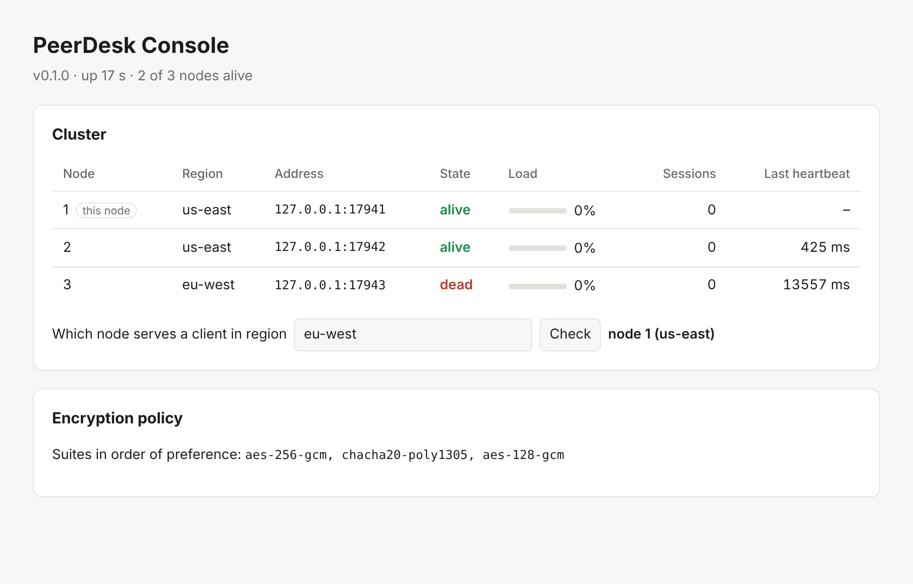

# PeerDesk

开源的远程桌面：远程操作和文件传输，支持 Windows、macOS、Linux。目标是流量低、操作跟手。
能直连就直连；直连失败才走中继。

许可证：Apache 2.0。

> 当前状态：**第一个可安装的测试版**。被控端采集真实屏幕（Windows、macOS、Linux X11）、
> 注入真实键鼠；画面用 H.264 编码，经 QUIC 传输；控制端在窗口里显示并操作。
> 没有采集屏幕或控制键鼠的权限时不提供远程（界面会说明原因和去哪里授权），不会拿合成画面顶替。
> 合成的演示桌面只用在自动化测试里，命令行要明确写 `--source demo` 才会用。

## 1.0 进度

| 部分 | 状态 |
| --- | --- |
| 协议、加密策略、会话握手 | 完成 |
| QUIC 传输、设备身份与指纹校验 | 完成 |
| 访问授权：密码、失败锁定、受信任设备、只读和禁传文件 | 完成 |
| 视频编码：H.264（OpenH264 软件编码），编解码在独立线程 | 完成；硬件编码未开始 |
| 码率自适应、前向纠错、丢失分片重传（NACK） | 完成 |
| 输入协议（冗余、防卡键）、系统输入注入 | 完成 |
| 文件传输（多文件、目录、断点续传、校验） | 完成 |
| 服务端集群、区域路由、节点间认证、管理页面 | 完成 |
| 仿真器、端到端测试（真实编码器 + 仿真网络 + 接近真实的桌面画面）、三平台 CI | 完成 |
| 屏幕采集（Windows DXGI、macOS ScreenCaptureKit、Linux X11） | 完成；Wayland 未支持 |
| 测试版界面（egui）和 Windows / macOS 安装包 | 完成 |
| 剪贴板 | 未开始 |
| 硬件编码器、AV1 | 未开始（需要带显卡的真机） |
| 信令、打洞、中继（含计量） | 完成：服务端提供信令和中继，客户端 `host --server` / `connect --device` 已接入 |
| Tauri 界面 | 未开始 |
| 托管云（账号、计费） | 排在最后 |

## 两个二进制

| 二进制 | 作用 | 发布体积（Linux x86-64） |
| --- | --- | --- |
| `peerdesk` | 客户端。双击打开测试版界面；也能用命令行（被控、控制、仿真、探测）。正式界面之后用 Tauri | 约 7 MB |
| `peerdesk-server` | 服务端。信令、中继、集群、区域路由、内嵌 React 管理页面 | 约 2.1 MB |

## 目录

```
crates/core     核心库：协议、加密、会话、分片重组、直连规划、集群、仿真。不做 IO
crates/media    视频编解码（H.264）
crates/net      网络层：QUIC 连接、设备身份、会话的 IO、文件读写
crates/platform 屏幕采集和输入注入（各系统）
crates/e2e      端到端测试平台（不随产品发布）
crates/client   客户端二进制（命令行和测试版界面）
crates/server   服务端二进制（构建时嵌入 web/dist）
web             React 管理页面（Vite）
config          配置示例
scripts         检查与发布脚本
```

## 常用命令

```bash
./scripts/check.sh            # 格式、严格 lint、全部测试、99% 行覆盖率门槛
./scripts/build-release.sh    # 构建管理页面和两个发布二进制
./scripts/e2e-live.sh         # 真实二进制闭环：Xvfb 上真采集、真注入，比对画面、验证输入执行（需要 Xvfb、xterm）
```

**图形界面（测试控制台）**：不带参数运行 `peerdesk`（或双击）打开。“本机”面板开启被控并显示地址、
指纹和每次启动随机生成的密码；“连接”面板填地址和密码，每个连接打开一个画面窗口（F12 显示统计）。
提交信息带 `[pkg]` 时 CI 会产出可下载的测试包：`peerdesk-<提交>-windows-x64`（ZIP，及 Inno Setup 安装程序）和
`peerdesk-<提交>-macos-universal`（DMG），包里的 `测试说明.txt` 说明了安装和首次运行的步骤。

两台机器之间用命令行试连（被控端共享本机屏幕，屏幕或键鼠打不开就报错退出；测试时可用 `--source demo`；
`--snapshot` 把看到的画面存成图片；`peerdesk screen-check --out a.bmp` 只测本机能不能截屏）：

```bash
export PEERDESK_PASSWORD='至少八个字符的密码'    # 两端都设置
peerdesk host --listen 0.0.0.0:4433            # 被控端：会打印监听地址和指纹
peerdesk connect <地址:端口> --pin <指纹> --snapshot seen.bmp --send <文件或目录>   # 控制端
peerdesk bench-transport                       # 本机回环上对比裸 UDP 和 QUIC 数据报的延迟
```

不知道被控端地址（在 NAT 后面）时，通过服务器连接：服务器配置里写上 `signal_listen`、`data_dir`
（可选 `relay_listen`），启动时会打印信令地址和服务器指纹。

```bash
peerdesk host --server <服务器地址:端口> --server-pin <服务器指纹>          # 被控端：登记在线
peerdesk connect --server <服务器地址:端口> --server-pin <服务器指纹> \
                 --device <被控端指纹>                                   # 先试直连（打洞），不通走中继
peerdesk connect ... --device <被控端指纹> --relay-only                  # 只走中继（--direct-only 只走直连）
```

控制端会打印实际走的路径（直连 / 中继）。管理接口的 `/api/status` 里有在线设备数和中继的转发总量。

```bash
cargo run -p peerdesk -- sim --link wifi --loss 30 --trace   # 在仿真网络上跑一次完整会话
cargo run -p peerdesk -- probe                                # 探测本机 CPU 指令集
cargo run -p peerdesk -- check-config config/client.example.toml
cargo run -p peerdesk-server -- config/server.example.toml
```

## 设计约定

- **核心库不做 IO**。时间和随机数由调用方传入，所以同一份逻辑既跑真实网络，也能在仿真里按种子原样重放。
- **仿真优先**。`peerdesk_core::sim` 模拟延迟、抖动、丢包、带宽限制、队列溢出、链路中断、比特损坏。
  新的传输逻辑先在仿真里验证，再接真实网络。
- **match 必须穷举**。全工作区禁止在枚举上使用通配分支（`clippy::wildcard_enum_match_arm`）：
  给枚举加成员时，所有相关的 match 都会编译失败，强制逐个处理。
- **处理网络输入的代码不允许 panic**。禁止 `unwrap`、`expect`、`panic!`、下标索引，禁止 `unsafe`。
- **失败必须有可见原因**。错误类型逐项列出原因，没有笼统的“未知错误”。

## 测试分类

| 类别 | 位置 | 内容 |
| --- | --- | --- |
| 单元 | 各模块内的 `mod tests` | 每个函数的行为 |
| 边界 | `crates/core/tests/boundary.rs` | 长度、数量刚好在上限和刚好越界 |
| 非法输入 | `crates/core/tests/invalid.rs` | 截断、乱码、随机字节、比特翻转，要求绝不 panic |
| 代码逻辑 | `crates/core/tests/logic.rs` | 会话状态机的每条转移，包括不允许的转移 |
| 业务链路 | `crates/core/tests/business.rs` | 端到端场景，用追踪记录断言走过的路径 |
| 仿真 | `crates/core/tests/simulation.rs` | 劣化网络、集群崩溃与分区、损坏注入、可重放性 |
| 探测 | `crates/core/tests/probe.rs` | 从探测结果到连接策略、硬件档位、服务器选择 |
| 文件传输 | `crates/core/tests/file_transfer.rs` | 多文件、续传、损坏、不安全路径、乱序消息 |
| 真实连接 | `crates/net/tests/loopback.rs` | 回环上的真实 QUIC 会话：画面、输入、文件、指纹、套件 |
| 异常对端 | `crates/net/tests/misbehave.rs` | 畸形数据报、乱发控制消息、中途消失、传输中止 |
| 真实互联 | `crates/server/tests/cluster_live.rs` | 三个节点用真实 UDP 和 TCP 在回环地址上互联 |
| 二进制 | `crates/*/tests/binary.rs` | 对编译出的可执行文件做冒烟测试 |

业务链路追踪（`peerdesk_core::trace`）在线上同样开启：出问题时拿到的追踪文本，可以直接对照
`business.rs` 里的期望路径。

## 加密

可选套件：`aes-256-gcm`、`chacha20-poly1305`、`aes-128-gcm`、`none`。只提供公开标准化的 AEAD。

- 预设 `recommended`（默认）只允许加密；`fips` 只用 FIPS 批准的算法；`none` 不加密。
- 协商不会被动降级：只要两端有共同的加密套件，就不会选中 `none`；`none` 只在两端都明确允许时生效。
- 真实连接走 QUIC，加密由 TLS 1.3 提供，策略里的套件映射成 TLS 密码套件。QUIC 强制加密，
  所以 `none` 目前只在仿真里可用，真实连接要求策略里至少有一个加密套件。
- 设备身份是一张自签名证书（ECDSA P-256），指纹是证书的 SHA-256。连接时双向出示证书并验证签名，
  是否信任对方由指纹决定（`--pin`）。
- `fips` 预设只限定算法，不代表本项目通过了 FIPS 140 模块认证。文件校验用的 BLAKE3 也不是 FIPS 算法。
- 不加密时没有完整性保护，途中损坏的数据会被当作正常数据交付（仿真测试里有演示）。

## 集群与区域

- 服务端节点之间用 UDP 心跳互联，没有主节点。新节点只要认识任意一个老节点就能发现全体。
- 节点崩溃后先标为可疑、再标为死亡，不再接新会话；重启后自动回到集群。加机器只需要配一个 `peers`。
- 选择节点的顺序：未过载优先 → 内网优先 → 同区域优先 → `region_fallback` 里的顺序 → 延迟 → 负载。


