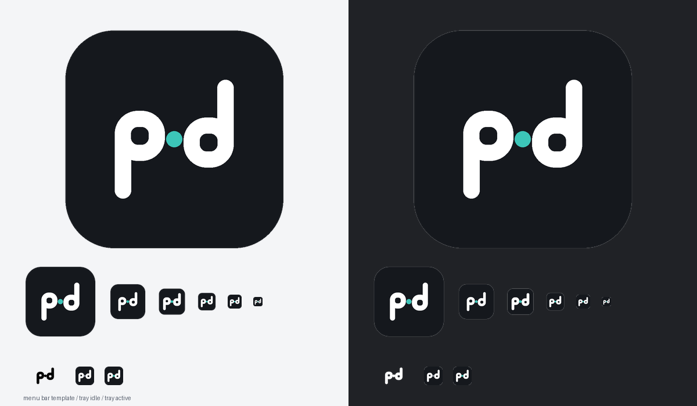

# PeerDesk 标志和图标

全部由 `scripts/make-icons.py` 从同一份几何参数生成，不要手改生成出来的文件。改标志就改脚本里的参数，
重新运行（`python3 scripts/make-icons.py packaging/icons/preview.png` 连预览图一起更新），再把结果一起提交。

## 标志

小写 **p** 和 **d**，d 就是 p 转 180°：

- 两端是对等的同一个软件（peer），所以两个字母是同一个形状，整个标志绕中心转 180° 不变。
- 两个碗是两块屏幕（desk）。
- 中间的点是两台设备之间的直连，用直连青绿 `#3CC5B8`。和界面的规则一致：颜色只用来说连接。

底是墨色 `#15181D`，标志白色。20 格画法，中心 (10, 10)。

### 光学尺寸

和字体一样，小图单独画，不是大图缩小：

| 尺寸 | 版本 | 笔画 | 标志占方块 |
|---|---|---|---|
| 64 px 及以上 | 标准 | 2.4 格 | 62% |
| 48 px 及以下 | 小图 | 2.8 格 | 74%，点放大 |

### 不撞已有标志

远程桌面同行的标志：TeamViewer 双箭头、AnyDesk 红色菱形、RustDesk 蓝色方块、向日葵花、ToDesk 蓝色、
Parsec、Splashtop、Chrome 远程桌面都不是这个形状。"pd" 两个字母的组合，知名品牌里 PagerDuty
用的是绿色全小写文字标，没有这种图形标。

## 使用规范

- **颜色**：墨色底 `#15181D`、白色标志、直连青绿点 `#3CC5B8`。单色场合（菜单栏、印刷、水印）整个标志用一种颜色，点也同色。
  不换别的品牌色，不加渐变、描边、阴影（macOS 图标网格自带的投影除外）。
- **留白**：标志四周至少留一个碗的笔画宽度（20 格里的 2.4 格）。
- **最小尺寸**：方块图标 16 px；只有标志时 12 px。小于 48 px 用小图版，不要把大图直接缩小。
- **不改形状**：不旋转、不拉伸、不把 p 和 d 拆开用、不换字体重写"pd"。两个字母必须保持互为 180° 旋转。
- **和文字一起**：横排时标志在左，文字 "PeerDesk" 用 Inter 600，字高和碗的高度一致，间距一个碗宽。
- **托盘**：点的颜色只表示连接状态（灰 = 没人连，青绿 = 有人连着），不用来装饰。

## 文件

| 文件 | 用在哪 |
|---|---|
| `preview.png` | 设计预览：浅色、深色背景上的大图，各尺寸，菜单栏和托盘 |
| `peerdesk.svg` | 矢量母版（方块），网站、Linux 的 scalable 图标 |
| `peerdesk-mark.svg` | 只有标志，`currentColor` 着色，文档、网页里用 |
| `peerdesk-{16..1024}.png` | Linux 各尺寸（.deb 装到 hicolor），网站 |
| `peerdesk.ico` | Windows：exe 里的图标（`crates/client/build.rs` 编进去）、安装程序 |
| `peerdesk.icns` | macOS：`PeerDesk.app/Contents/Resources`，按苹果图标网格（1024 画布里 824 的方块，带投影） |
| `tray-template.png`、`@2x` | macOS 菜单栏模板图（纯黑加透明，系统按深浅色着色），18 pt |
| `tray-idle-*.png`、`tray-active-*.png` | Windows、Linux 托盘：平时点是灰的，有人连着时点亮青绿 |
| `crates/client/assets/window-icon.png` | 窗口图标，编进客户端 |
